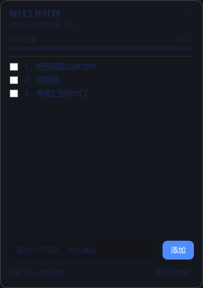
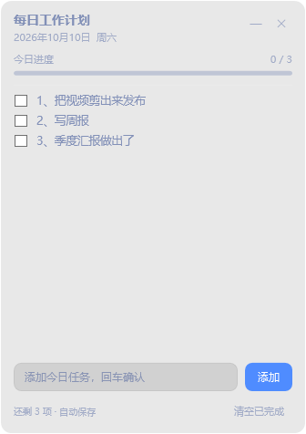

# 每日工作计划栏（桌面小浮窗）

一个贴在桌面右上角、**始终置顶**的每日工作计划浮窗。纯 Windows PowerShell 5.1 + WPF 实现，
不依赖任何第三方组件，绿色免安装。

深色桌面上（`preview-on-dark.png`）：



浅色桌面上（`preview-on-light.png`）——**当前配色的目标场景**，深蓝文字就是为它配的：



## 现在就能用

浮窗此刻**已经在运行**了（窗口标题「每日工作计划」），就在屏幕右上角。

## 关掉之后怎么重新打开

双击桌面上的快捷方式：**「每日工作计划栏」**

> 如果双击后「看起来没反应」，通常是因为它**已经在运行了** ——
> 程序有单实例保护，检测到已有实例就会直接退出，避免出现两个浮窗。
> 抬头看一下屏幕右上角即可。

## 功能

| 操作 | 说明 |
| --- | --- |
| 顶部标题区拖动 | 移动浮窗位置（位置会被记住） |
| 输入框 + 回车 / 「添加」 | 添加今天的任务 |
| 点任务前的复选框 | 标记完成，进度条和「还剩 N 项」实时更新 |
| 任务右侧 ✕ | 删除该条任务 |
| 头部 `—` | 收起成一条细栏（只留标题 + 进度），再点 `▸` 展开 |
| 头部 `✕` | 退出浮窗 |
| 右键面板 | 收起/展开、重新载入今日、退出 |
| 底部「清空已完成」 | 一键清掉已勾选的任务 |

- **自动保存**：每次改动立即写入本地，不存在「忘了保存」。
- **按天分栏**：数据按日期存放，跨天自动切换成新的一天（保留最近 30 天）。
- **单实例**：不会重复启动出第二个浮窗。

## 数据在哪

```
G:\dsh\desktop-plan\data\plan.json    # 任务数据（按日期，留最近 30 天）
G:\dsh\desktop-plan\data\ui.json      # 窗口位置 / 收起状态
G:\dsh\desktop-plan\data\app.log      # 运行日志（排查问题用）
```

纯文本 JSON，可以直接查看或备份；删掉 `data` 目录就是清空所有记录。

## 让开机自动启动

1. 按 `Win + R`，输入 `shell:startup` 回车，打开「启动」文件夹；
2. 把桌面上的「每日工作计划栏」快捷方式**复制**进去。

（这一步我没有替你做，因为那会改变开机行为。需要的话告诉我，我来加。）

## 文件清单

| 文件 | 作用 |
| --- | --- |
| `DailyPlan.ps1` | 主程序（界面 + 逻辑，唯一需要维护的文件） |
| `start-daily-plan.vbs` | 静默启动器（不闪黑框），桌面快捷方式指向它 |
| `start-daily-plan.cmd` | 带控制台的启动器，排查报错时用 |
| `preview-render.ps1` | 开发用：把界面按真实 alpha 渲染并合成到浅/中/深底色，用来判断对比度 |
| `preview-on-light.png` / `preview-on-mid.png` / `preview-on-dark.png` | 三种桌面底色下的效果预览 |
| `preview-rgba.png` | 带真实 alpha 的渲染图（半透明信息就在这个文件里） |
| `data\` | 数据目录，自动生成 |

## 实现备注

- **背景不透明度 10%**：面板色 `#1A191B22`，其中 `1A` = 26/255 ≈ 10% 不透明。
  想改就改这个 alpha 值（前两位）：

  | alpha | 不透明度 | 效果 |
  | --- | --- | --- |
  | `FF` | 100% | 完全不透明（纯色板） |
  | `CC` | 80% | 略微透出桌面 |
  | `80` | 50% | 半透明 |
  | `4D` | 30% | 偏透明的磨砂感 |
  | `33` | 20% | 接近隐形 |
  | `1A` | **10%（当前）** | 几乎完全透出桌面，只剩文字和控件 |

- **文字：深蓝 `#1E3A8A`**，按层级用不同不透明度（alpha 是色值前两位）：

  | 用途 | 色值 | 不透明度 |
  | --- | --- | --- |
  | 标题、任务文字 | `#801E3A8A` | **50%** |
  | 日期、进度、底部提示、`—` `✕`、清空按钮 | `#591E3A8A` | 35% |
  | 已完成任务 | `#4D1E3A8A` | 30%（另加删除线） |
  | 输入框内文字 | `#CC1E3A8A` | 80% |
  | 输入框占位提示 | `#661E3A8A` | 40% |

- **不再需要文字阴影**：深色文字配深色阴影会糊成一团，所以 `DropShadowEffect` 已移除。
  换回浅色文字的话，记得把阴影加回来，否则浅色桌面下会看不见。
- **注意使用场景**：深蓝文字是为**浅色桌面**设计的。因为面板只有 10% 不透明，
  面板颜色会跟着桌面走 —— 桌面偏暗时面板也偏暗，深蓝文字对比度会明显下降。
  如果常在深色背景下用，把文字换成浅色 + 加回阴影。
- **进度条**：底槽 `#331E3A8A`（20% 深蓝，压在浅底上是很淡的一条），
  已完成部分 `#4F8CFF`。底槽太深会在浅色桌面上显得很重。
- **输入框**：浅色半透明底 `#1A000000`（10% 黑）+ `#26000000` 描边，
  这样深蓝文字才看得见；「添加」按钮保持蓝底白字（按钮上的字换深蓝会看不见）。
- 半透明用的是 WPF **逐像素 alpha**（`AllowsTransparency="True"`），所以只有背景变透明，
  文字和控件按自己的不透明度绘制；圆角由 `Border.CornerRadius` 提供。
  代价是该窗口走软件渲染，对这么小的面板没有影响。
- 脚本文件必须保存为 **UTF-8 with BOM**：Windows PowerShell 5.1 在没有 BOM 时会按 ANSI
  读取 .ps1，脚本里的中文会乱码甚至导致语法错误。改动本文件后请保持 BOM。
- 改完可以做两项自检：

  ```powershell
  # 解析界面 XAML、校验全部命名控件、载入数据（不显示窗口）
  powershell -NoProfile -STA -File DailyPlan.ps1 -SelfTest

  # 重新生成三种底色下的效果预览
  powershell -NoProfile -STA -File preview-render.ps1
  ```
